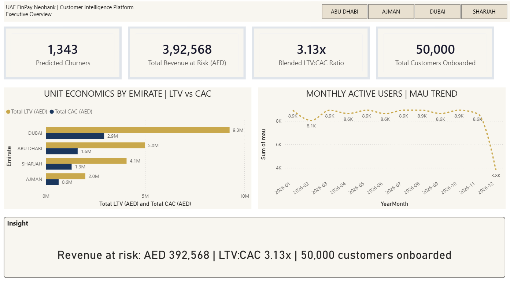
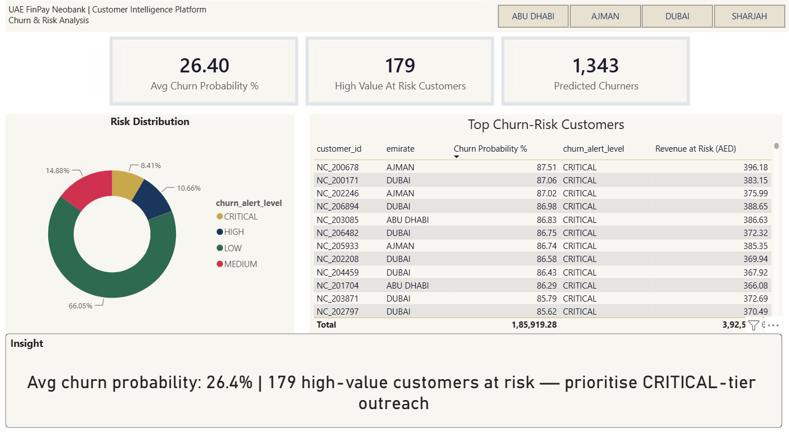
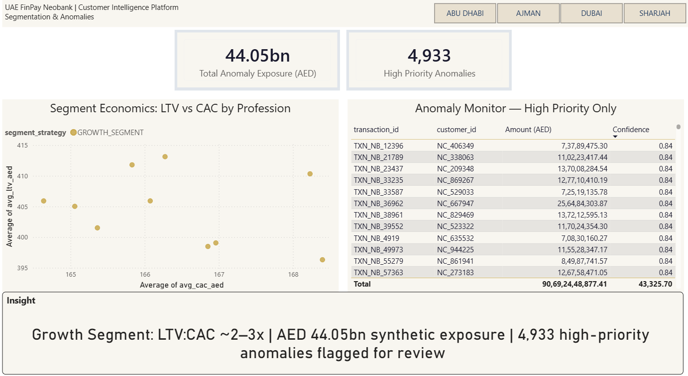
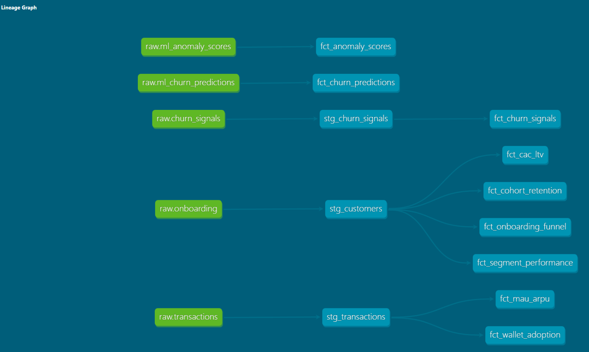
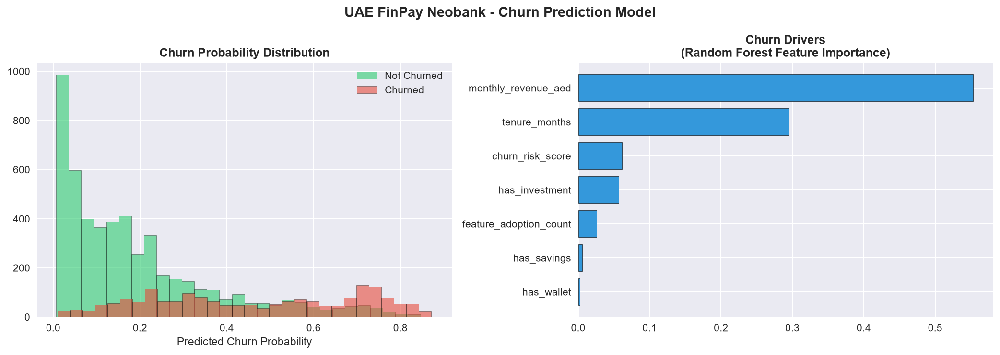
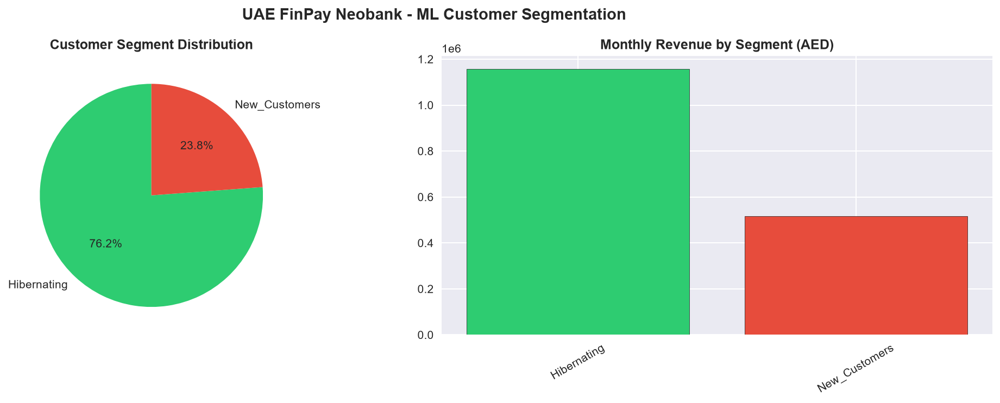

# UAE FinPay — Neobank Customer Intelligence Platform

### Predictive Churn • CAC/LTV Unit Economics • Customer Segmentation • Transaction Anomaly Detection


> An end-to-end customer intelligence platform for a UAE digital-first neobank: customer economics, cohort retention, predictive churn, ML segmentation, transaction anomaly detection, and a three-page Power BI decision layer — built on a fully local, free stack.

**Portfolio disclosure:** UAE FinPay is a fictional company created for this portfolio. All customer, transaction and financial data is synthetic or adapted from public datasets (PaySim, IBM Telco Churn) and enriched with a UAE context (AED currency, emirate distribution, KYC-related fields).

**Built for:** Financial Analytics, Customer Analytics, Product Analytics, Business Intelligence and BI-with-ML roles in UAE fintech, digital payments and neobanking.

---

## Executive Summary

This project connects **customer economics, lifecycle analytics and machine learning** in one governed pipeline using **Python, PostgreSQL, dbt and Power BI**.

Instead of leaving ML output inside a notebook, model results are **written back to PostgreSQL**, modelled by dbt into governed marts, and consumed by the Power BI semantic model — so churn risk can be read next to CAC, LTV and revenue context by emirate and month in a single report.

```text
raw data → dbt staging → dbt marts → Python ML → PostgreSQL → dbt ML marts → Power BI
```

---

## Dashboard Preview

<p align="center">
  
  
  
</p>

Full-size pages with metric definitions are in the Power BI Decision Layer section below.

---

## Key Findings

| Area | Result |
|---|---|
| Best churn model | Logistic Regression — **AUC-ROC 0.8232** (20% stratified hold-out) |
| Comparison model | Random Forest — AUC-ROC 0.7712 |
| Predicted 30-day churners | **1,343** of 7,043 modelled customers (19.1%), probability threshold 0.50 |
| Monthly revenue at risk | **AED 392,568** |
| Blended LTV:CAC | **3.13x** for KYC-completed customers (**2.44x** across all 50,000 customers) |
| ML segmentation | KMeans, **k=3** (silhouette-selected, k tested 2–7) → resolves to two business labels |
| Segment split | **Hibernating 76.2%** (5,366) / **New Customers 23.8%** (1,677) |
| Anomaly detection | Isolation Forest, 5% contamination → **4,987 of 99,990 transactions** flagged (5.0%) |
| High-priority anomalies | **4,933** flagged transactions of AED 10,000 or more |

A separate **rule-based** segment field in the dbt layer (`segment_strategy`) collapsed to a single tier, `GROWTH_SEGMENT`, across every profession. This is a synthetic-data limitation, documented here rather than presented as meaningful segmentation.

---

## Business Problem

A digital-first neobank needs more than dashboards that describe the past. Growth, product, finance and risk teams need to know:

- Which customers are likely to churn in the next 30 days, and how much revenue that exposes.
- Which acquisition channels and professions produce customers worth their CAC.
- Where customers drop out between signup, KYC and activation, and how that differs by emirate.
- How retention evolves from M1 to M12 by signup cohort.
- Which transactions look unusual enough to send for manual review.
- Whether the customer base has real behavioural segments, or whether apparent segmentation is a data artefact.

## Business Objectives

1. Map the onboarding funnel and drop-off by emirate.
2. Quantify CAC, LTV and payback by channel, profession and emirate.
3. Track M1–M12 cohort retention, MAU and ARPU.
4. Predict 30-day churn probability and convert it to revenue at risk.
5. Segment customers with unsupervised learning.
6. Flag anomalous transactions for review.
7. Deliver all of the above through one Power BI semantic model.

---

## Data Lineage



```text
Raw / adapted source data (PaySim • synthetic onboarding • Telco churn)
        ↓
PostgreSQL raw schema
        ↓
dbt staging (3 views): cleaning • standardisation • UAE adaptation
        ↓
dbt marts (7 tables): finance • product • risk
        ↓
Python ML layer: churn prediction • segmentation • anomaly detection
        ↓
ML outputs written back to PostgreSQL (raw.ml_churn_predictions, raw.ml_anomaly_scores)
        ↓
dbt ML marts (2 tables): fct_churn_predictions • fct_anomaly_scores
        ↓
Power BI semantic model (DimEmirate, DimMonth, DAX measures)
        ↓
3-page decision layer
```

---

## Technology Stack

| Layer | Technology |
|---|---|
| Language / ML | Python 3.12, pandas, scikit-learn |
| Warehouse | PostgreSQL 17 |
| Transformation | dbt Core 1.11 (12 models, 19 tests) |
| BI | Power BI Desktop, DAX (PBIP + PBIX) |
| Version control | Git / GitHub |

The project deliberately uses a **local stack with no cloud dependency**, so it can be reproduced without paid services.

## Data Scale

| Item | Value |
|---|---|
| Customers onboarded (synthetic) | 50,000 |
| Transactions (PaySim stratified sample, after staging) | 99,990 |
| Customers in the churn model (Telco-adapted) | 7,043 |
| Emirate mix (synthetic weights) | Dubai 45% • Abu Dhabi 25% • Sharjah 20% • Ajman 10% |
| Currency | AED, converted at 3.67 |
| Timeline | Synthetic timestamps from 1 Jan 2026 at 5-minute intervals, ending mid-December 2026 |

---

## Analytical Framework

### 1. Onboarding & Customer Analytics
Signup volume, KYC completion, time to KYC, time to first transaction and activation by emirate (`fct_onboarding_funnel`).
*Question: where are customers lost between signup and activation?*

### 2. Customer Economics
CAC, LTV, ARPU and payback period by emirate, channel and profession (`fct_cac_ltv`, `fct_segment_performance`).
*Question: which acquisition sources create economically attractive customers?*

### 3. Cohort Retention
M1–M12 retention by signup cohort (`fct_cohort_retention`), read alongside MAU and ARPU (`fct_mau_arpu`).
*Question: is growth coming from acquisition or from sustained engagement?*

### 4. Churn Prediction & Revenue at Risk
- **Features:** tenure, monthly revenue, wallet / savings / investment adoption, feature-adoption count, and the RFM-style `churn_risk_score` from dbt.
- **Method:** 80/20 stratified split; Logistic Regression (scaled features) compared with Random Forest (100 trees); best model selected on AUC-ROC.
- **Output:** churn probability, predicted churn flag (probability > 0.50), segment label and monthly revenue per customer, written back to PostgreSQL.
- **Revenue at risk:** sum of monthly revenue for customers flagged as predicted churners.

### 5. Customer Segmentation
KMeans on tenure, monthly revenue, feature adoption and churn probability. Silhouette score chose **k=3**. The three clusters were mapped by rule to business labels, and resolved to two: **Hibernating** and **New Customers**.

### 6. Transaction Anomaly Detection
Isolation Forest (100 trees, 5% contamination) on `amount_aed` and the source `is_fraud` flag. Flags are **analytical review signals, not fraud determinations**, and are tiered in dbt:

| Tier | Rule |
|---|---|
| HIGH_PRIORITY | anomaly and amount ≥ AED 10,000 |
| MEDIUM_PRIORITY | anomaly and amount ≥ AED 5,000 |
| LOW_PRIORITY | any other anomaly |

Of the 4,987 flagged transactions, 4,933 are high priority and 4,957 exceed AED 5,000, so the flags are dominated by transaction size (see Limitations).

---

## Power BI Decision Layer

The Power BI report has three pages, built on the dbt marts through PostgreSQL, with a shared emirate slicer and a custom UAE FinPay theme. The semantic model contains 15 DAX measures in a dedicated `_Measures` table.

### Page 1 — Executive Overview

Headline KPIs (predicted churners, revenue at risk, blended LTV:CAC, customers onboarded), unit economics by emirate (LTV vs CAC) and the monthly active users trend. Dubai leads in absolute LTV and CAC, reflecting the 45% synthetic Dubai weighting rather than a behavioural finding. The last MAU point is low because December 2026 is a partial month in the synthetic timeline.


### Page 2 — Churn & Risk Analysis

Average churn probability (26.4%), predicted churners (1,343), high-value customers at risk (179), the risk-tier distribution (Low / Medium / High / Critical) and a ranked list of top churn-risk customers with revenue at risk.


### Page 3 — Segmentation & Anomalies

Segment economics (LTV vs CAC by profession), total anomaly exposure, high-priority anomaly count and an anomaly monitor ranked by model confidence. All professions fall in the same `GROWTH_SEGMENT` tier. The AED exposure figure comes from scaled PaySim amounts and is a synthetic magnitude, not a realistic neobank figure.


### Metric Definitions

| Metric | Definition |
|---|---|
| Revenue at Risk | Sum of monthly revenue for customers with predicted churn flag = 1 |
| Predicted Churners | Count of customers with predicted churn flag = 1 |
| Blended LTV:CAC | Total LTV ÷ total CAC across KYC-completed customers (`fct_cac_ltv`); 2.44x across all customers |
| High Value At Risk | **Rule-based** RFM flag: monthly revenue ≥ AED 300 and risk score ≥ 8 (`fct_churn_signals`) — separate from the ML prediction |
| High Priority Anomalies | Anomalies of AED 10,000 or more |
| Total Anomaly Exposure | Sum of amounts for all flagged anomalies |

---

## Python & Machine Learning Analysis

The notebook `notebooks/uae_finpay_neobank_ai_analytics.ipynb` trains the three models, writes results to PostgreSQL and saves the charts below.

### Churn model — probability distribution and drivers

Monthly revenue and tenure are the dominant drivers in the Random Forest importance ranking.



### Customer segmentation — distribution and revenue by segment



---

## Business Impact

**Growth & Marketing** — compare acquisition channels on CAC-to-LTV, not volume; identify cohorts with weak retention; size the revenue exposed to predicted churn.

**Product** — monitor MAU and ARPU, activation and KYC friction, and behavioural segments.

**Finance** — connect acquisition spend to LTV; track revenue exposure from predicted churn.

**Risk & Operations** — prioritise customers by predicted churn risk; surface anomalous transactions for human review, separate from confirmed fraud.

## Business Recommendations

1. **Prioritise retention activity by revenue at risk**, starting with CRITICAL-tier customers, rather than treating every predicted churner equally.
2. **Judge channels on CAC-to-LTV economics**, not acquisition volume.
3. **Watch early-lifecycle behaviour** (KYC completion, time to first transaction) to find activation friction.
4. **Read cohort retention together with MAU and ARPU** to separate acquisition growth from sustainable engagement.
5. **Treat anomaly flags as a review queue** that needs human investigation before any conclusion.
6. **Monitor segmentation stability** over time, especially on synthetic or adapted data.

These are analytical recommendations from a portfolio model, not operational instructions for a regulated institution.

---

## Data Quality & Methodology Notes

- **dbt:** 12 models (3 staging views, 9 mart tables), 19 tests passing on the staging layer (uniqueness, not-null, accepted values).
- **Staging filter:** `stg_transactions` keeps only rows with `amount_aed > 0`, which removes 10 zero-amount rows (all fraud-labelled), so staging, `fct_mau_arpu` and `fct_wallet_adoption` carry 99,990 of the 100,000 raw transactions. `fct_cac_ltv` and `fct_cohort_retention` include only KYC-completed customers (38,907 of 50,000); the 11,093 customers without KYC have no first transaction and no positive LTV.
- **SQL validation:** `sql_analysis/neobank_data_validation.sql` runs 65 pass/fail checks (17 data quality, 23 business rules, 11 reconciliation, 14 README-figure verification) plus 5 informational customer-ID coverage rows; all pass. The two documented filters above are encoded as explicit expectations rather than hidden.
- **Sources:** PaySim-derived transactions, synthetic onboarding data, Telco churn adapted to a neobank context, and Python-generated ML outputs.
- **PaySim amounts** are multiplied by 3.67 to express them in AED.
- The churn AUC is measured on the held-out 20%; predicted-churner counts and revenue at risk are scored on the **full** 7,043-customer base, including training rows.

## Limitations

1. Data is synthetic or adapted from public datasets, not proprietary UAE banking data; behaviour may not match a real UAE neobank.
2. The churn model is trained on 7,043 Telco-adapted customers; its performance reflects that dataset and feature set.
3. Predicted churn is a probability, and revenue at risk is an exposure estimate, not realised loss.
4. Revenue at risk and predicted churners are scored in-sample (see above); a production model would need out-of-time validation and monitoring.
5. The Isolation Forest is unsupervised (no target is used in fitting), but its two inputs are `amount_aed` and the PaySim `is_fraud` flag, and the transaction sample was stratified to about 5% fraud-labelled rows — matching the 5% contamination setting. About 99% of flagged transactions exceed AED 5,000, so flags mainly reflect transaction size. They should not be read as independent fraud discovery.
6. The rule-based dbt segmentation collapsed to a single `GROWTH_SEGMENT` tier; the KMeans clusters resolved to two labels.
7. Blended LTV:CAC is 3.13x for KYC-completed customers (`fct_cac_ltv`) but 2.44x across all 50,000 customers, because customers who never complete KYC add acquisition cost without proportionate LTV. The lower all-customer figure (also used in `fct_segment_performance`) is the more conservative view.
8. Synthetic timestamps run to mid-December 2026, so the final month in trend charts is partial.
9. Customer IDs are generated independently in the onboarding (`NC_1xxxxx`), churn (`NC_2xxxxx`) and transaction datasets, so there is no customer-level join across them. The Power BI model connects them at emirate and month level, not per customer. Matching IDs do occur by coincidence (4804 of 95117 transacting customers match an onboarding ID, 650 of 7043 churn customers match a transaction ID, 0 match between churn and onboarding; see CV-01 to CV-05 in `sql_analysis/`) and none is used for a join.
10. In the synthetic onboarding data, LTV equals monthly revenue × tenure (1–18 months), so it represents revenue to date rather than a forward-looking lifetime value.
11. The neobank feature flags in the churn data are proxies mapped from Telco fields (phone service → `has_wallet`, multiple lines → `has_savings`, fibre internet → `has_investment`).
12. The project has not been validated by a regulated institution, MLRO, compliance officer or external auditor.

---

## UAE Regulatory & Governance Context

The project references UAE regulatory concepts to show domain awareness. It does **not** claim UAE FinPay is a regulated institution or that the project is a compliance implementation. See **[COMPLIANCE.md](COMPLIANCE.md)** for the CBUAE AML/CFT/CPF and PDPL context.

---

## Reproducing the Project

1. Create a PostgreSQL 17 database `neobank_db` with schemas `raw` and `dbt_dev`.
2. Download the PaySim and IBM Telco Churn CSVs from Kaggle into a local `data/` folder (not committed).
3. Set the database password as an environment variable — credentials are never stored in the repo:
   ```powershell
   $env:NEOBANK_DB_PASSWORD = "<your-local-password>"
   ```
4. Run `python prepare_data.py` to load the raw tables.
5. From `dbt_project/uae_finpay_neobank`, run `dbt run --exclude fct_churn_predictions fct_anomaly_scores`, then `dbt test`.
6. Run the notebook to train the models and write `raw.ml_churn_predictions` and `raw.ml_anomaly_scores`.
7. Run `dbt run` again to build the two ML marts.
8. Open `uae_finpay_neobank_analytics.pbip` in Power BI Desktop.

---

## Project Structure

```text
uae-finpay-neobank-analytics/
|-- README.md
|-- COMPLIANCE.md
|-- data_dictionary.md
|-- LICENSE
|-- prepare_data.py                      # loads PaySim, synthetic onboarding and Telco data into the raw schema
|-- dashboards/                          # Power BI page screenshots (3 pages)
|-- charts/                              # ML charts from the AI notebook
|-- docs/lineage.png                     # dbt lineage graph
|-- notebooks/uae_finpay_neobank_ai_analytics.ipynb
|-- sql_analysis/neobank_data_validation.sql
|-- dbt_project/uae_finpay_neobank/      # dbt project: models/staging, models/marts (finance, product, risk)
|-- uae_finpay_neobank_analytics.pbix    # Power BI report (single file)
|-- uae_finpay_neobank_analytics.pbip    # Power BI project (source-control format)
|-- uae_finpay_neobank_analytics.Report/
`-- uae_finpay_neobank_analytics.SemanticModel/
```

## Documentation

| Document | Purpose |
|---|---|
| [Data Dictionary](data_dictionary.md) | Raw, ML and mart table definitions |
| [Compliance & Regulatory Context](COMPLIANCE.md) | UAE regulatory and data-governance context |
| [Data Lineage](docs/lineage.png) | End-to-end architecture |
| [SQL Validation Suite](sql_analysis/neobank_data_validation.sql) | Data-quality, business-rule, reconciliation and README-figure checks against neobank_db |

---

## Portfolio Disclaimer

UAE FinPay is a fictional portfolio company. All customer, transaction and financial information is synthetic or adapted from public datasets. This project demonstrates financial analytics, data engineering, machine learning and business intelligence capability. It is **not** a production banking system, regulatory submission, financial product, fraud investigation system or compliance implementation.

---

## Contact

**Kunal Sharma** — [GitHub](https://github.com/KunalFinData) • [LinkedIn](https://www.linkedin.com/in/kunalsharma0425)

## Related Portfolio Projects

- **Project 1 — [Payment Analytics & Fraud Risk Intelligence Engine](https://github.com/KunalFinData/uae-finpay-fraud-risk-sql)**
- **Project 2 — [BNPL Default Risk Predictor & Expected Loss Model](https://github.com/KunalFinData/uae-finpay-bnpl-risk-python)**
- **Project 3 — Neobank Customer Intelligence Platform** (this repository)
- **Project 4 - [AML Transaction Monitoring & RegTech Compliance Engine](https://github.com/KunalFinData/uae-finpay-aml-regtech)**
